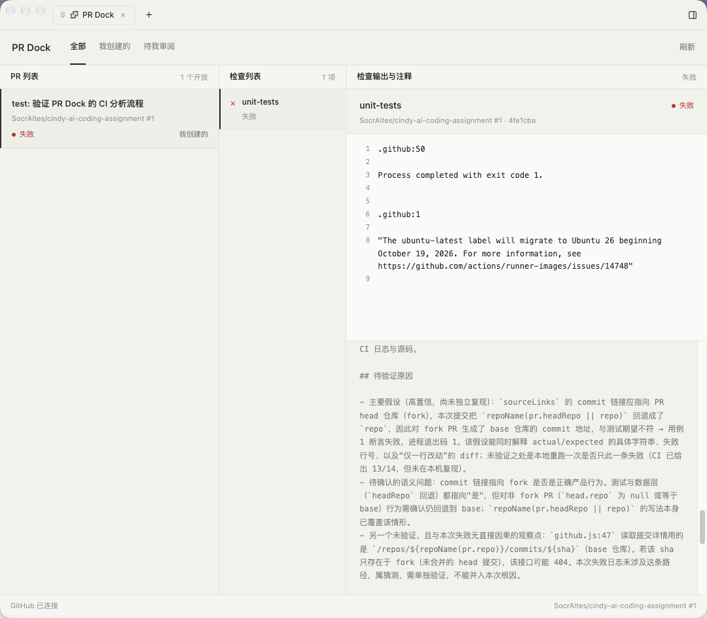

# PR Dock

在 Cindy 中查看个人 GitHub PR 和 CI 状态，选择失败检查后交给 Cindy 排查。

## 安装与使用

当前版本为 0.1.5，已在 Cindy 0.1.126 上安装验证。内部插件 ID 为 `pr-workbench`。

1. 在 Cindy 内置 Forge 中选择本目录的 `plugin/`，校验、打包并安装。
2. 通过宿主连接 GitHub CLI 登录。也可在插件设置中保存备用 PAT，由宿主管理凭证。
3. 打开 PR Dock（命令 `pr看板`），刷新列表，选择 PR 和检查。
4. 查看输出或打开对应的 PR、提交和检查页面；选择失败检查后发起分析。面板显示任务进展和 ID，后续可从 Cindy 任务列表继续查看。

列表合并本人创建和待本人审阅的开放 PR，每页 20 条。CI 区分通过、失败、运行中、未知和无检查。输出来自 GitHub 检查摘要与注释，完整 Actions 日志通过原始检查链接查看。

测试结果和原始记录见[验证记录](VALIDATION.md)。

## 运行截图

Cindy 中的 PR、失败检查、输出与分析结果：



## 开发与测试

所有命令从本目录执行。行为测试需要 Node.js 22 以上，无须安装依赖：

```sh
node --test test/*.test.mjs
```

界面检查使用 Playwright：

```sh
npm install
npx playwright install chromium
npm run test:ui
```

界面脚本使用 25 条模拟 PR，不访问 GitHub、不创建真实任务。覆盖状态、分页、过滤、fork 链接、异步切换及 320、390、736、1100 四种宽度。截图默认保存到临时目录，可作为脚本首个参数指定；`PR_DOCK_BROWSER_EXECUTABLE` 可指定本机浏览器，运行时使用隔离资料目录。

源码入口：

| 文件 | 职责 |
| --- | --- |
| `plugin/main.js` | 消息处理、界面与任务接口 |
| `plugin/github.js` | GitHub 数据读取 |
| `plugin/core.js` | 状态、链接和分析交接 |
| `plugin/list-status.js` | 列表 CI 状态调度 |
| `plugin/panel.*`、`plugin/settings.*` | 面板与设置页 |

设计判断及开发中遇到的问题见[答卷 B1](../ANSWER.md#b1做一个插件)。故障案例的复现方法见[测试 PR 说明](../demo/README.md)。
